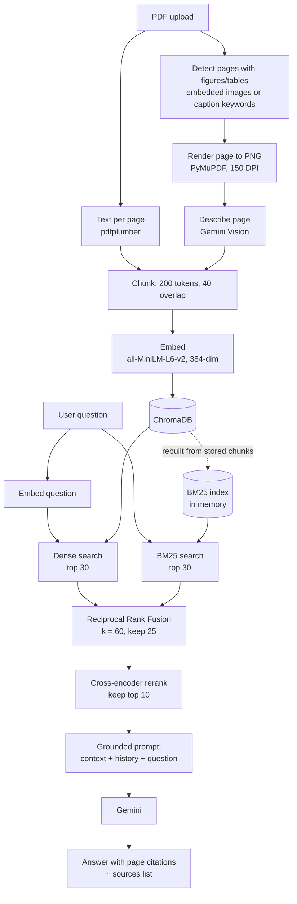

# Multimodal Document Intelligence System

Ask questions about your PDFs and get answers grounded in the documents, with **page-level citations**. Retrieval is **two-stage hybrid search** (BM25 + dense embeddings fused with Reciprocal Rank Fusion, then a cross-encoder reranker), figures and tables are read by a **vision-language model**, and two documents can be **compared** side by side. Retrieval runs locally on CPU, and only answer generation and figure descriptions call the Gemini API.

**Live demo:** [multimodal-document-intelligence.streamlit.app](https://multimodal-document-intelligence-szgugehyamdfzdxzqjvhq6.streamlit.app/)

**Stack:** Python · Streamlit · Sentence Transformers · ChromaDB · rank-bm25 · Google Gemini

---

## Results

Retrieval ablation on 27 labelled questions (15 generated from the source text, 12 hand-paraphrased), with 3 PDFs indexed. A result counts as correct if it comes from the page that contains the answer.

| Retrieval setup | HitRate@3 | HitRate@10 | MRR@10 | NDCG@10 | p50 latency | p95 latency |
|---|---|---|---|---|---|---|
| Dense only (MiniLM) | 0.778 | 0.963 | 0.677 | 0.448 | 16 ms | 19 ms |
| Sparse only (BM25) | 0.815 | 0.926 | 0.781 | 0.432 | 1 ms | 2 ms |
| Hybrid (BM25 + dense, RRF) | 0.889 | 0.963 | 0.847 | 0.498 | 19 ms | 23 ms |
| **Two-stage (hybrid + cross-encoder)** | **0.963** | **0.963** | **0.907** | **0.554** | 828 ms | 909 ms |

- **Ranking, not just recall:** every setup finds the right page in the top 10 about equally often. Two-stage retrieval puts it in the **top 3 for 26 of 27 questions**, against 21 for dense search alone, and raises **MRR@10 from 0.677 to 0.907**.
- **Hybrid beats either search alone:** BM25 catches exact codes and names that embeddings blur; dense search catches paraphrases that keywords miss.
- **Trade-off, measured:** the reranker costs about 0.8 s per question on a laptop CPU (Ryzen 5 5500U), against about 20 ms for hybrid search alone.
- **End to end with Gemini:** Recall@10 is **96%** and MRR@10 **0.91**; on the paraphrased questions alone, 92% and 0.88.

Reproduce with `python benchmarks/benchmark_retrieval.py` (no API calls) and `python eval/run_evaluation.py`. Full tables are in [`benchmarks/benchmark_results.md`](benchmarks/benchmark_results.md), and per-question answers in [`eval/eval_report.md`](eval/eval_report.md).

## Engineering highlights

- **Two-stage retrieval:** BM25 and dense search (top 30 each) are fused with RRF (k = 60, top 25), then a cross-encoder (`ms-marco-MiniLM-L-6-v2`) picks the 10 chunks sent to the LLM.
- **Single source of truth:** the BM25 index is rebuilt in memory from the chunks stored in ChromaDB whenever documents change, so the keyword and vector indexes can't drift apart.
- **Thread-safe model loading:** Streamlit serves each session on its own thread. The ChromaDB client and the reranker are created once behind a shared lock, which fixed a real `KeyError` crash from concurrent client creation in deployment.
- **Multimodal without a second index:** pages with figures or tables are rendered and described by Gemini Vision, and the descriptions are indexed as text, so charts are searchable through the same pipeline.
- **Exact chunking:** chunks are 200 tokens counted with the embedding model's own tokenizer, so nothing is silently truncated at MiniLM's 256-token limit, and chunks never cross pages, so every citation points to exactly one page.
- **Honest evaluation:** generated questions reuse the source's wording and flatter keyword search, so a hand-paraphrased set is reported separately. Every answer in the app shows a per-stage latency breakdown.

---

## Features

- **PDF upload and indexing**: upload one or more PDFs; text is extracted page by page.
- **Figure and table understanding**: pages that contain figures, charts, tables or diagrams are rendered as images and described by Gemini Vision, so visual content becomes searchable.
- **Two-stage hybrid search**: keyword search (BM25) and semantic search (`all-MiniLM-L6-v2` embeddings in a local ChromaDB vector database) are combined with Reciprocal Rank Fusion, then a cross-encoder reranks the candidates. Exact terms such as codes and names are found as well as paraphrased meaning.
- **Grounded answers with citations**: answers are generated only from retrieved passages, cite the document and page number, and list their sources (marked as text or figure/table).
- **Multi-turn chat**: follow-up questions use the conversation history.
- **Document comparison**: compare two documents' methods or findings, with evidence drawn from each document separately.
- **Latency breakdown**: each answer shows how long every retrieval stage and the LLM call took.
- **Evaluation and benchmarking**: an evaluation over generated and hand-paraphrased questions, and a retrieval benchmark comparing dense, BM25, hybrid and two-stage retrieval (HitRate@K, MRR@K, NDCG@K, p50/p95 latency).

---

## How it works



**Indexing.** Each PDF is read once. Text is extracted per page. Pages likely to contain visuals (an embedded image, or a caption word such as "figure", "table" or "chart") are rendered to images, up to 15 per document, and Gemini writes a factual description of each. Text and descriptions are split into chunks that never cross a page boundary, so every chunk maps to exactly one page for citations.

**Chunk size.** Chunks are 200 tokens with a 40-token overlap, counted with the embedding model's own tokenizer. `all-MiniLM-L6-v2` reads at most 256 tokens, so every chunk is embedded in full and nothing is silently truncated.

**Retrieval (two stages).**
1. *Candidate search.* Two searches run on the question. Dense search embeds it with MiniLM and returns the 30 nearest chunks from ChromaDB; it matches meaning, even when the wording differs. BM25 returns the 30 best keyword matches; it catches exact terms such as codes, numbers and rare names that embeddings can blur. The tokenizer keeps hyphenated terms like `XJ-4471-B` as one token.
2. *Fusion.* Reciprocal Rank Fusion combines the two ranked lists: each chunk scores `1 / (60 + rank)` in every list it appears in, duplicates are merged, and the best 25 are kept. RRF uses only ranks, so the two searches' incompatible score scales don't matter.
3. *Reranking.* The cross-encoder `cross-encoder/ms-marco-MiniLM-L-6-v2` reads the question and each candidate together and scores how well the passage answers it. This is more accurate than comparing separate embeddings, but too slow to run on every chunk, which is why it only sees the 25 candidates. The top 10 go to Gemini.

The BM25 index is held in memory and rebuilt from the chunks stored in ChromaDB whenever documents are added or removed, so the two indexes always contain the same chunks. Both models run locally on CPU and are loaded once and shared across sessions, behind a lock so that parallel Streamlit sessions don't load them twice.

**Answering.** Gemini answers using only the 10 reranked chunks. The prompt tells it to say "I don't know" when the answer isn't in the context, which reduces hallucination. Under **Sources**, the app shows how long each stage took for that question.

**Comparison.** The comparison question runs through the whole two-stage retrieval twice, once per document, with every stage (dense, BM25 and reranking) restricted to that document. Both documents therefore contribute 10 chunks of evidence, even if one is much longer.

The original project specification is in [`SPEC.md`](SPEC.md).

---

## Tech stack

| Component | Tool |
|---|---|
| Interface | Streamlit |
| PDF text extraction | pdfplumber |
| Page rendering | PyMuPDF |
| Embeddings | Sentence Transformers (`all-MiniLM-L6-v2`), runs locally on CPU |
| Vector database | ChromaDB (persistent, local) |
| Keyword search | `rank-bm25` (BM25Okapi), in memory |
| Reranker | Sentence Transformers cross-encoder (`cross-encoder/ms-marco-MiniLM-L-6-v2`), runs locally on CPU |
| LLM and vision | Google Gemini (`gemini-flash-lite-latest`) |

---

## Project structure

```
├── app.py                  # Streamlit interface
├── src/
│   ├── pipeline.py         # Orchestrates ingestion, Q&A and comparison
│   ├── pdf_utils.py        # Page-by-page text extraction
│   ├── pdf_render.py       # Visual-page detection and page rendering
│   ├── chunking.py         # Token-based chunking with overlap
│   ├── embeddings.py       # Sentence Transformer embeddings
│   ├── vector_store.py     # ChromaDB storage, dense search, BM25 index and RRF fusion
│   ├── reranker.py         # Cross-encoder reranking
│   └── gemini_client.py    # Gemini calls: answers, image descriptions, comparison
├── eval/
│   ├── build_eval_set.py   # Generates a question set from indexed chunks
│   ├── run_evaluation.py   # Runs the questions through the full pipeline (with Gemini)
│   ├── metrics.py          # HitRate@K, MRR@K, NDCG@K, precision and percentiles
│   ├── eval_set.json       # 15 questions generated from the document
│   ├── eval_set_paraphrased.json  # 12 hand-paraphrased questions
│   └── eval_report.md      # Latest results
├── benchmarks/
│   ├── benchmark_retrieval.py     # Dense vs BM25 vs hybrid vs two-stage ablation
│   └── benchmark_results.md       # Latest benchmark tables
├── tests/                  # Manual test scripts for each component
├── requirements.txt
└── .env.example            # Template for the API key
```

---

## Getting started

**Requirements:** Python 3.10+ (developed on 3.12) and a free Gemini API key from [Google AI Studio](https://aistudio.google.com/).

```bash
# 1. Create and activate a virtual environment
python -m venv venv
venv\Scripts\activate          # Windows
# source venv/bin/activate     # macOS / Linux

# 2. Install dependencies
pip install -r requirements.txt

# 3. Add your API key
copy .env.example .env         # Windows  (macOS / Linux: cp .env.example .env)
# then edit .env and set GEMINI_API_KEY=<your key>

# 4. Run the app
streamlit run app.py
```

The first run downloads the embedding model and the reranker (about 90 MB each). The vector database is created in `chroma_db/` the first time you process a document.

---

## Usage

1. Upload one or more PDFs in the sidebar and click **Process documents**.
2. Ask questions in the chat box. Expand **Sources** under an answer to see the documents and pages used, and the time each retrieval stage took.
3. With two or more documents indexed, open **Compare Documents**, pick two, and optionally enter a comparison focus.

---

## Evaluation

The system was evaluated on 27 questions about a 35-page lecture chapter, each linked to the page that contains its answer: 15 generated from the text and 12 hand-paraphrased so that they share few words with it. A retrieved chunk counts as relevant if it comes from that page. All three test PDFs were indexed, so other documents also competed for the top slots.

| Question set | Questions | Recall@10 | MRR@10 |
|---|---|---|---|
| All | 27 | **96%** (26 of 27) | **0.91** |
| Generated from the text | 15 | 100% | 0.93 |
| Hand-paraphrased | 12 | 92% | 0.88 |

The single miss is a paraphrased question whose answer page is mostly figure captions. Per-question results and answers are in [`eval/eval_report.md`](eval/eval_report.md).

**Retrieval benchmark.** `benchmarks/benchmark_retrieval.py` runs the same questions through dense-only, BM25-only, hybrid and two-stage retrieval without calling Gemini, and reports HitRate, MRR and NDCG at K = 3, 5 and 10 plus p50/p95 latency. The summary is under [Results](#results); full tables, including a breakdown by question set, are in [`benchmarks/benchmark_results.md`](benchmarks/benchmark_results.md).

To evaluate on your own document (after indexing it in the app):

```bash
python eval/build_eval_set.py "<document_name.pdf>"   # generate questions (review them before use)
python eval/run_evaluation.py                         # writes eval/eval_report.md
python benchmarks/benchmark_retrieval.py              # retrieval ablation, writes benchmarks/benchmark_results.md
```

`build_eval_set.py` has Gemini write questions from passages of the document, each linked to the page it came from, so their wording is close to the source text. Add hand-paraphrased questions to `eval/eval_set_paraphrased.json` for a stricter test; both files are used by the evaluation and the benchmark.

---

## Tests

The scripts in `tests/` check each component and are run directly with Python:

| Script | Checks | Needs API key |
|---|---|---|
| `test_phase1_manual.py` | Text extraction, chunking, embeddings, storage and retrieval | No |
| `test_hybrid_retrieval.py` | BM25 tokenization and exact-code matching, document filter, RRF scores and deduplication, reranker latency (no database used) | No |
| `test_gemini_key.py` | The API key works | Yes |
| `list_gemini_models.py` | Lists Gemini models available to the key | Yes |
| `test_full_pipeline.py` | End-to-end question answering with citations | Yes |
| `test_phase3_multimodal.py` | Chart detection, page rendering and figure description | Yes |
| `test_phase4_comparison.py` | Two-document comparison | Yes |

```bash
python tests/test_phase1_manual.py
python tests/test_hybrid_retrieval.py
```

Apart from `test_hybrid_retrieval.py` and the two key-check scripts, these add small test documents to `chroma_db/` in the folder they are run from. Run `python tests/cleanup_test_doc.py` afterwards to remove them.

---

## Limitations

- Scanned PDFs (images of text) are not supported, as no OCR is applied.
- Visual pages are found with a heuristic, so a chart without a caption keyword can be missed, and at most 15 pages per document are described.
- Retrieval uses only the latest question, so vague follow-ups ("explain more") may retrieve weaker context.
- Reranking 25 candidates on a laptop CPU takes about 0.8 s per question (Ryzen 5 5500U), which is most of the retrieval time. Gemini's answer still takes longer.
- The first question after the app starts takes several seconds longer, because the embedding model and the reranker are loaded on first use.
- The BM25 index is rebuilt in memory from all chunks whenever documents change; this is fast for a few thousand chunks but would need an incremental index at larger scale.
- The free `flash-lite` model gives less detailed descriptions of complex figures than larger models.
