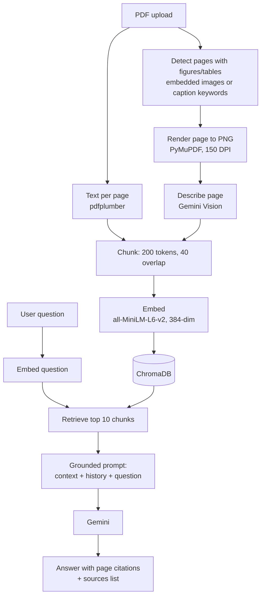

# Multimodal Document Intelligence System

A document question-answering assistant built with **Retrieval-Augmented Generation (RAG)** and a **vision-language model**. Upload PDFs (research papers, lecture notes, technical reports), ask questions in plain English, and get answers grounded in the documents with **page-level citations**. The system also reads **figures, charts and tables**, and can **compare two documents** side by side.

Built with Python, Streamlit, Sentence Transformers, ChromaDB and the Google Gemini API.

---

## Features

- **PDF upload and indexing**: upload one or more PDFs; text is extracted page by page.
- **Figure and table understanding**: pages that contain figures, charts, tables or diagrams are rendered as images and described by Gemini Vision, so visual content becomes searchable.
- **Semantic search**: text and figure descriptions are embedded with `all-MiniLM-L6-v2` and stored in a local ChromaDB vector database.
- **Grounded answers with citations**: answers are generated only from retrieved passages, cite the document and page number, and list their sources (marked as text or figure/table).
- **Multi-turn chat**: follow-up questions use the conversation history.
- **Document comparison**: compare two documents' methods or findings, with evidence drawn from each document separately.
- **Evaluation pipeline**: scripts to build a question set and measure retrieval quality (Recall@K, Precision@K).

---

## How it works



**Indexing.** Each PDF is read once. Text is extracted per page. Pages likely to contain visuals (an embedded image, or a caption word such as "figure", "table" or "chart") are rendered to images, up to 15 per document, and Gemini writes a factual description of each. Text and descriptions are split into chunks that never cross a page boundary, so every chunk maps to exactly one page for citations.

**Chunk size.** Chunks are 200 tokens with a 40-token overlap, counted with the embedding model's own tokenizer. `all-MiniLM-L6-v2` reads at most 256 tokens, so every chunk is embedded in full and nothing is silently truncated.

**Answering.** The question is embedded with the same model, the 10 most similar chunks are retrieved, and Gemini answers using only that context. The prompt tells it to say "I don't know" when the answer isn't in the context, which reduces hallucination.

**Comparison.** The comparison question is run as two separate searches, each filtered to one document, so both documents contribute evidence even if one is much longer.

The original project specification is in [`SPEC.md`](SPEC.md).

---

## Tech stack

| Component | Tool |
|---|---|
| Interface | Streamlit |
| PDF text extraction | pdfplumber |
| Page rendering | PyMuPDF |
| Embeddings | Sentence Transformers (`all-MiniLM-L6-v2`), runs locally on CPU |
| Vector database | ChromaDB (persistent, local) |
| LLM and vision | Google Gemini (`gemini-flash-lite-latest`) |

---

## Project structure

```
├── app.py                  # Streamlit interface
├── src/
│   ├── pipeline.py         # Orchestrates ingestion, Q&A and comparison
│   ├── pdf_utils.py        # Page-by-page text extraction
│   ├── pdf_render.py       # Visual-page detection and page rendering
│   ├── chunking.py         # Token-based chunking with overlap
│   ├── embeddings.py       # Sentence Transformer embeddings
│   ├── vector_store.py     # ChromaDB storage and similarity search
│   └── gemini_client.py    # Gemini calls: answers, image descriptions, comparison
├── eval/
│   ├── build_eval_set.py   # Generates a question set from indexed chunks
│   ├── run_evaluation.py   # Runs the questions and computes metrics
│   ├── eval_set.json       # The 15 evaluation questions
│   └── eval_report.md      # Latest results
├── tests/                  # Manual test scripts for each component
├── requirements.txt
└── .env.example            # Template for the API key
```

---

## Getting started

**Requirements:** Python 3.10+ (developed on 3.12) and a free Gemini API key from [Google AI Studio](https://aistudio.google.com/).

```bash
# 1. Create and activate a virtual environment
python -m venv venv
venv\Scripts\activate          # Windows
# source venv/bin/activate     # macOS / Linux

# 2. Install dependencies
pip install -r requirements.txt

# 3. Add your API key
copy .env.example .env         # Windows  (macOS / Linux: cp .env.example .env)
# then edit .env and set GEMINI_API_KEY=<your key>

# 4. Run the app
streamlit run app.py
```

The first run downloads the embedding model (about 90 MB). The vector database is created in `chroma_db/` the first time you process a document.

---

## Usage

1. Upload one or more PDFs in the sidebar and click **Process documents**.
2. Ask questions in the chat box. Expand **Sources** under an answer to see the documents and pages used.
3. With two or more documents indexed, open **Compare Documents**, pick two, and optionally enter a comparison focus.

---

## Evaluation

The system was evaluated on 15 questions about a 35-page lecture chapter, each linked to the page that contains its answer. A question counts as a hit if that page is among the 10 retrieved chunks.

| Metric | Result |
|---|---|
| Recall@10 | **93%** (14 of 15) |
| Precision@10 | 24% |

Each question has exactly one correct page while 10 chunks are retrieved, so precision is low by design. Recall is the more meaningful measure here. The single miss was labelled with the table-of-contents page; the system retrieved the page where that section actually begins and still answered correctly. Per-question results are in [`eval/eval_report.md`](eval/eval_report.md).

To evaluate on your own document (after indexing it in the app):

```bash
python eval/build_eval_set.py "<document_name.pdf>"   # generate questions (review them before use)
python eval/run_evaluation.py                         # writes eval/eval_report.md
```

The questions are generated by Gemini from passages of the document, each linked to the page it came from, so their wording is close to the source text. Hand-written, paraphrased questions would give a stricter test.

---

## Tests

The scripts in `tests/` check each component and are run directly with Python:

| Script | Checks | Needs API key |
|---|---|---|
| `test_phase1_manual.py` | Text extraction, chunking, embeddings, storage and retrieval | No |
| `test_gemini_key.py` | The API key works | Yes |
| `list_gemini_models.py` | Lists Gemini models available to the key | Yes |
| `test_full_pipeline.py` | End-to-end question answering with citations | Yes |
| `test_phase3_multimodal.py` | Chart detection, page rendering and figure description | Yes |
| `test_phase4_comparison.py` | Two-document comparison | Yes |

```bash
python tests/test_phase1_manual.py
```

These scripts add small test documents to `chroma_db/` in the folder they are run from. Run `python tests/cleanup_test_doc.py` afterwards to remove them.

---

## Limitations

- Scanned PDFs (images of text) are not supported, as no OCR is applied.
- Visual pages are found with a heuristic, so a chart without a caption keyword can be missed, and at most 15 pages per document are described.
- Retrieval uses only the latest question, so vague follow-ups ("explain more") may retrieve weaker context.
- Search is purely semantic (no keyword/BM25 hybrid or re-ranking), so exact codes or rare names can occasionally be missed.
- The free `flash-lite` model gives less detailed descriptions of complex figures than larger models.
